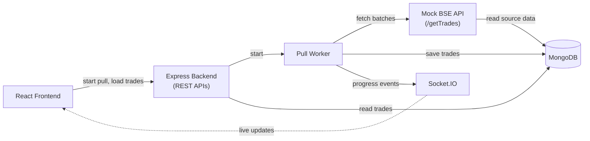

# TradeFlow - Architecture

## Overview

TradeFlow pulls trade data from a mock BSE Exchange API and shows it on a live dashboard. A full pull can take up to 15 minutes, but the network closes any HTTP connection open for more than 30 seconds. So the pull runs in the background in small batches, and the dashboard is updated in real time while it runs.

## Architecture Diagram

## Main Components

**React frontend:** The dashboard. It shows the trades table, stats and pull progress, and has the Pull Trades button. It uses REST to load data and Socket.IO to receive live updates.

**Express backend (REST APIs):** Starts a pull, and returns trades, stats and the latest pull job from MongoDB.

**Pull worker:** An async function in the backend (`services/pullWorker.js`). It fetches trades page by page from the mock BSE API, saves them and tracks progress.

**Mock BSE API:** The `GET /getTrades` endpoint, served by the same Express app. It returns seeded trades one page at a time and waits a little before each page, so a full pull takes the configured time (up to 15 minutes).

**Socket.IO:** Sends events (`pull:started`, `pull:progress`, `pull:completed`, `pull:failed`) from the server to all open dashboards.

**MongoDB:** Stores the mock source data (`source_trades`), the imported trades (`trades`) and the pull jobs (`pulljobs`).

## Trade Ingestion Flow

1. The user clicks **Pull Trades**. The frontend calls `POST /api/pulls`.
2. The backend creates a pull job, starts the worker in the background and replies right away with `202`. If a pull is already running, it replies `409`.
3. The worker calls `/getTrades` with a cursor, 50 trades at a time. Each request has a timeout and is retried if it fails.
4. Each batch is saved to the `trades` collection. Trades that already exist are skipped. The worker then updates the job counters (processed, inserted, duplicates, batches done).
5. After every batch the worker sends a `pull:progress` event through Socket.IO. The dashboard updates the progress panel and reloads the trades and stats, so new rows appear without a refresh.
6. When there are no more pages, the job is marked `completed` and `pull:completed` is sent. If a batch keeps failing, the job is marked `failed` and `pull:failed` is sent.

## Key Design Decisions

**Batch requests:** Fetching everything in one request would hit the 30 second limit. The pull starts with one quick request, and the worker then makes many short requests. Each batch is saved immediately, so trades already pulled stay visible on the dashboard during a pull.

**REST APIs:** REST gives the real current state, so the dashboard uses it for the first load and to refresh data after a reconnect. This also means the dashboard opens right away, without waiting for a pull.

**Socket.IO:** The server pushes updates when something changes, so the dashboard does not need to refresh the page or poll the server.

**MongoDB:** Trades fit naturally as documents. A unique index on `tradeId` together with an upsert on each batch prevents duplicate trades, and the pull job documents keep the status and progress.
